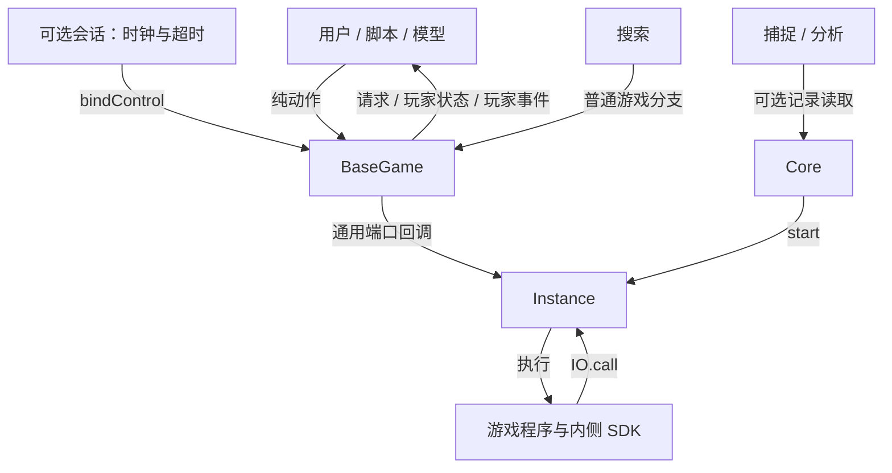

# 三层与横向能力

当前第二层设计入口：[类型化原子函数与组合规则](card-core-spec.md#typed-rule-layer)。稳定内核／规则模块／组合实体是 Program 内的组织方式，与本页 Core／Instance／BaseGame 的运行职责不同。作者定义引用在装配时链接，动态登记和续接仍属于唯一 Context；类型化作者、模块提交、查询、派发、检查点和实体生命周期已有生产实现，STS 铁甲内容通过这些接口装配；验收范围及实际结果见 plan.md。

| 功能 | Core | Instance | BaseGame |
| --- | --- | --- | --- |
| 创建与执行 | 装载程序、创建实例 | 推进、读取停止状态、关闭 | 持有实例，解释游戏状态 |
| 输入输出 | 程序与端口声明 | 发出调用、接受一次返回 | 游戏请求、动作、事件 |
| 玩家交互 | — | — | 请求直接指定 player，状态和事件投影 |
| 合法动作 | — | 校验端口结构 | 游戏描述并校验动作 |
| 会话控制，可选 | — | 普通端口返回 | 独立 bindControl，游戏解释时间/超时 |
| 保存恢复，可选 | 提供恢复能力 | 完整现场保存 | 复用实例保存 |
| 分支，可选 | — | 同类型独立实例 | 同类型独立游戏 |
| 捕捉，可选 | 提供记录访问 | 记录调用与返回 | 上层解释训练和分析数据 |

Core 提供执行机制并加载共享 Program。Instance 持有独立 Context，其中是跨外部 call 所需的显式控制位置、局部值、调用帧、闭包捕获数据、对象引用图、SDK 状态及待决调用；不是原生 JS 栈或整份模块导出图。BaseGame 持有 Instance 的外部控制权。配套 lib `@bear-forge/game-sdk` 和游戏领域 SDK 属于被执行内容；玩家回调和外侧 GameContract 处理器在宿主侧。

编译受控程序内访问宿主状态或服务只有一条路径：声明端口并执行 `IO.call`，由 Instance 暂停后交给外侧处理，再把返回值作为数据送回。受控编译产物、依赖和内侧 SDK 都遵守同一条边界；不能通过全局对象、宿主函数、getter 或包名豁免直接调用宿主。V8 的纯语言计算和程序自有状态仍在边界内执行，不必包装成 IO。编译准入与运行时守卫负责拒绝无法满足这条规则的受控程序。直接装载的原生 `ProgramModule` 属于受信任代码，不受 IO-only 保证约束。



## 完整原生 GameHost 与受控能力

专用卡牌路径的性能单位是能够完成实际玩家交互的一局 GameHost。正常游戏包括规则、观察、选项、动作/控制验证、事件交付和终局；这些工作在原生与受控两种模式中相同。Core 执行规则，Instance 持有唯一现场，BaseGame 表达交互职责；三个公共接口不要求三个内部世界、逐层复制或逐层建立所有权系统。

默认原生使用普通状态直接执行正常游戏，不构造未启用的 COW、版本页、训练采集、调用/步骤记录或存档数据。游戏历史不能删除。显式记录消费者使用既有可选能力，单列其成本。受控复用同一正常游戏路径，增加状态隔离、预算、记录与分支/持久化能力；只有请求 save/restore 才付对应编解码成本。

框架内部转发稳定数据只传引用与小量元数据；跨真实消费者边界仍保持校验和数据隔离。用户已选择 GameContract 纯只读借用：作者适配函数在两模式下共享稳定发布数据，执行世界仍不外泄；schema、玩家和公开返回值保持独立副本。未知 Instance 返回先隔离准入，不因实现形状或类型就取得私有借用资格。不增加公开开关或新的运行层。原生游戏本身的重复导出、校验和历史扫描也要审查，不能将其作为固定底座。

以上是用户更正后的目标结构，尚未全部实现。七条局部路径只用于定位，完整基准与双模式独立目标见 card-core-spec.md；当前按用户要求冻结性能优化，进度见 plan.md。

## 代码与实例上下文

这是三层内部的代码/数据边界，不增加公共协议层或 Context 导出类型。

```text
产物 ──加载一次──> 共享 Program（代码、静态标识、不可变元数据）
                           │
                 runtime 调用（Context、端口返回）
                           │
                 运行到外部 call 或正常结束
                           │
                 Context A ──fork──> Context B
                 共享代码；实例可变数据完全隔离
```

编译器把跨 call 的续接信息放进 Context，边界内计算交给 V8。保存只编码 Context，恢复只装入 Context 并关联已加载代码；冷进程先加载一次匹配产物。实现由 compiler 分离静态注册和实例初始化，runtime-controlled 的 LoadedProgram 共用注册表，ProgramExecution 持有 Context。装载时用临时 Context 完成 schema 准入，随后释放；start 初始化新局，fork 共享 Context 的持久化存储根，并令父子后续写入按需分离；restore 读回独立 Context。fork 不遍历完整状态，首次推进不补做全量复制；fork/restore 都不调用模块初始化。编译器按闭包捕获需求生成共享变量单元的投影，闭包不持有整个父执行帧。没有作用域切换的函数按实际捕获集合分配局部槽：被子闭包捕获的变量使用独立单元，其余槽直接保存值；祖先捕获仍通过独立变量单元访问。普通严格同步调用的未捕获槽、局部作用域数组及控制帧使用临时记录；捕获变量使用独立单元，闭包只保留其投影。编译器向祖先传播后代闭包的写入集合；严格同步调用中，后代不会重新赋值的捕获绑定使用普通值单元，其引用对象仍按 COW 隔离。有作用域切换时按所有深度的写入槽索引并集保守排除；可写捕获及可挂起函数继续使用 COW 单元。异步/生成器及其包装函数保留 COW。有作用域切换时保留单元访问方式，按子闭包在各层的捕获槽索引并集保守划分：可能被捕获的槽使用独立单元；其余槽在同步函数中使用临时值记录，在可挂起函数中共享 COW 存储组，防止捕获变量连带保留无关局部数据。严格 arguments 是与参数槽分离的原生 Arguments 对象，其属性随 Context 分支，恢复保留品牌和描述符。同一实例内的捕获投影按来源词法作用域与路径复用共同祖先容器；变量单元仍属于 Context，fork/restore 保留内部别名并隔离不同实例的写入；可证明已死且未捕获的平坦局部值在 await 前释放；可达性包含普通续接、异常和 return 清理路径，作用域切换或可达的未知跳转仍保守保留。fork 不经过持久化编解码器；记录共享不可变分块前缀。schemas 的实例值及实际捕获环境随 Context 保存；只有程序实际引用导出命名空间或使用入口 this 时，才保留对应可变数据和别名。

受控路径在 LoadedProgram 装载时创建一个 V8 Realm，把作者代码、内建值、操作表和续延设备装入其中。宿主输入复制成该 Realm 的数据；对外的端口请求和合法 JSON 结果复制回宿主。Program Realm 不属于 Context，多个 Instance 共享它；fork/restore 不新建 Realm。原生路径仍在宿主 Realm 执行，不提供 fork/restore；直接传入的函数可以持有宿主闭包或跨实例共享的模块变量。

普通对象属性存储将名称、插入顺序和标志与作者值分离。每页最多 32 个内部槽，数据值或 getter 每槽只占一个值条目；setter 数组仅在需要时创建。分支首次写入只分离命中的值页，共享布局保持不变，后续同页值写入不再复制。只有定义、删除或属性标志改变才分离该页布局；小对象的第一页直接存放，只有后续页才建立持久化索引；第一页用所有权标记在 fork 后按需分离，fork 不遍历对象或页。对外反射按当前页重新生成描述符，普通自有属性读取直接取值。 静态属性读取由编译器分配调用点，运行库为每个调用点保留至多四个数字槽位提示；每次都先读取当前 Context 的对象状态，并验证该槽的当前属性名。命中直接读当前值和标志，未命中走完整属性/原型解析。提示不保留作者对象、值或分支状态，不进入快照。 缺失字段缓存校验属性容器的结构版本、原型弱引用及分支原型版本。缓存前标记经过的所有可变原型；之后增删原型属性或改变原型链时递增该分支版本。版本由共享编号器分配，避免兄弟分支相同修改次数碰撞；未知原生原型不缓存。缓存不强持有可变原型。

调试作用域表属于共享 Program 元数据，装载时只登记按需读取器；首次实际读取调试作用域时才展开完整父作用域表并复用结果。变量名、遮蔽、位置和枚举内容保持原样，正常执行及 fork/restore 不需要展开这些表。

## 数据流

1. 装载程序，Core.start 运行至首次端口等待或结束。
2. binder 接管 Instance，调用方提供与程序匹配的 GameContract。
3. 输入端口经 receive 产生 view 和请求列表；每个请求直接含 key/player/type/data。
4. BaseGame 为请求附加实例/调用身份、该玩家观察与合法动作描述，交给对应 onRequest。
5. 回调只返回动作。纯 respond 校验并编码为端口返回；原程序验证后结算。
6. 会话控制使用独立回调和游戏定义的数据，经独立 respond 编码到同一个端口；游戏决定时钟、超时和默认行为。
7. 游戏发布事件；projectEvent 按玩家生成可见事件，onEvent 接收入队。
8. 一次游戏 run 最多接受一个动作或会话控制，再交付后续事件，到下一请求、结束或暂停时返回具体接受结果。

同时选择由游戏保存部分输入、封存结果和发布剩余请求。外侧一次交付一个返回；结算顺序和共同决策结束条件在程序里。

## 源码目录

```text
packages/
  contracts/
    src/
      core/          program、core、loading 的类型及 schema
      instance/      instance、persistence、capture、branching
      game/          game、authoring、binding、session
      internal/      包内类型辅助
      index.ts       日常入口
      loading.ts     保持既有 /loading 公共入口的 re-export
    tests/
      core/          Core 层测试
      instance/      Instance 层测试
      game/          Game 层测试
      support/       共用协议测试夹具
      *.test.ts      跨层协议、schema 和依赖边界测试
  game-sdk/
    src/
    tests/
examples/
  doudizhu/
    src/
    tests/
```

协议文件按职责命名为 `*.types.ts` 和 `*.schemas.ts`。各层的公共导出和保存/捕捉兼容入口仅做 re-export。源码归属与包的公共导入路径分别管理；目录迁移保持下列导入路径不变。

## 包路径

```text
@bear-forge/contracts              十个日常入口类型
  /core                           程序、端口、创建
  /instance                       通用回调、单步运行、状态、关闭
  /game                           请求、纯动作、玩家交互
  /authoring                      游戏程序、SDK、共享端口、纯适配声明
  /session                        可选会话控制
  /persistence                    可选保存恢复
  /branching                      可选同类型分支
  /capture                        可选执行记录
  /loading                        装载、接管和可选能力组合
src/internal                      类型检查辅助工具
@bear-forge/game-sdk               可执行内侧 lib：createGameSDK
```

基础入口不导出保存、记录、训练或搜索辅助类型。基本 Core/Instance/Game 声明不依赖可选功能声明；loading 在接线时组合实际提供的能力。各模块 tests/architecture.test.ts 检查自身源码的依赖边界，包含在该模块的 npm test 中；根目录通过 workspaces 汇总。

游戏目录：schemas.ts 定义领域数据；types.ts 特化公开契约；card.ts 是专用结算流程，deal.ts 承载显式随机流发牌；rules.ts/patterns.ts 实现纯规则；contract.ts 声明纯处理器，module.ts 装配同一卡牌定义和契约。旧通用 async 主循环移入 tests/generic，公共 GameModule 协议仍用于通用程序。

C01 交付公共声明、完整斗地主及原生协议消费者。生产执行、保存续延及正式绑定器在 C02/C03 验收。

内侧 lib 与外侧功能的逐项对应、类型关联和语义法则见 protocol.md 的“内侧 lib 与外侧功能配套”。GamePortDeclarations 同时用于 Program 的端口 schema 与内侧函数生成；GameContract 受同一端口类别/输入/返回类型约束。Core/Instance 不依赖该游戏声明或 lib。lib 不持有 BaseGame、Instance 控制句柄或宿主回调。

测试归属对应模块：contracts/tests 验证公共契约；game-sdk/tests 验证内侧库及游戏接口接线；doudizhu/tests 验证具体游戏。contracts/tests/support 的协议夹具由依赖模块的测试复用，不作为生产包导出。

## 完整系统实现

生产模块、原生与受控两条路径、游戏领域记录、策略、实验存储和关系展示的实施方案见 [implementation-spec.md](implementation-spec.md)。这些模块通过现有公开接口组合，不修改本页三层边界。实现目录与审核入口见 project-overview.md；进度以 plan.md 为准。

执行实例均在主 runtime 内直接调用编译产物，代码按产物缓存，模块变量/闭包/执行帧按实例持有。受控路径仅在 Program 装载时创建 V8 Realm；创建 Instance、fork 和 restore 不创建 Realm。没有 Worker 或执行子进程。只有编译预算检查，不提供硬超时。测试中的新进程用于证明关闭程序后仍能从持久快照恢复，不是执行器的实例承载机制。

## 并列卡牌后端

2026-10-20 的 STS 前置设计进一步区分同一 Program 内的执行指令、规则支持函数及游戏规则包。执行器仅解释通用控制流和端口；队列、触发登记、修正计算及其时序由规则代码实现，动态数据全部归入既有 Context。卡牌、敌人、遗物不是执行器分支。该划分不增加运行层或公共协议，详见 [可扩展规则模型](card-core-spec.md#extensible-rules) 与 [证明](card-core-proof.md#extensible-rules-proof)；类型化规则底座及固定源铁甲 A20 内容已实现；有限验收不代表其他职业或任意插件均已验证。

用户 2026-10-17 授权专用卡牌路径。通用源码→编译产物→ProgramExecution 与卡牌定义→CardProgram/CardMachine 两条路径并列，共同实现 Core/Instance/BaseGame 协议。后者在 packages/card-engine 声明步骤和同步推进，在 packages/runtime-card 实现 COW 数据图、装载、快照和记录重放；不依赖 compiler/runtime-controlled/runtime-native。

Card Core 共享静态定义，Card Instance 的单一图根保存世界、结算帧、局部值、待决调用、随机流和游标。原生模式用普通数据，受控模式以持久索引和数组固定页实现写时分离。Controller 和 BaseGameBinder 仍管理外部调用和玩家交互。受控卡牌路径的同步规则操作属于受信任有界函数；任意 JS 的语义/宿主访问准入仍由原通用路径负责。详见 card-core-spec.md 与 card-core-proof.md。

入口迁移和薄封装按后续推进授权实施：两游戏所有正式消费方装载同一卡牌定义；实验通过既有 LoadedCore 提供者装配选择模式，不再为卡牌游戏编译通用 Program。Instance/BaseGame 内部共享私有稳定停止态和 view，run 的返回状态直接用于刷新；GameContract 按用户确认的纯只读契约借用，schema、玩家及公开交付仍使用独立普通 DTO。私有发布值不是活动世界，不能把规则状态移出 Instance 或冻结 COW 代理。完整执行步骤与指标见 card-core-spec.md 的“入口迁移与薄封装执行方案”；实现、检查及性能是否完成仅以 plan.md 的证据为准。
